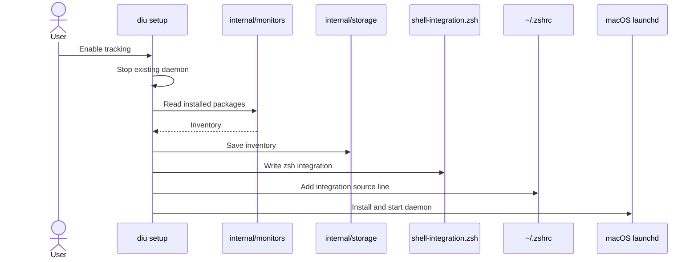

# CLI

<!-- source files and responsibilities from cmd/diu -->
```text
cmd/diu/
├── main.go         Entry point and commands
├── cli.go          Shared flags and output
├── config.go       Settings
├── daemon.go       Daemon control and login service
├── diagnostics.go  Diagnostic reports
├── executables.go  Tool discovery
├── inventory.go    Installed package scans
├── packages.go     Usage browser and uninstall
├── query.go        History and statistics
├── setup.go        Setup, uninstall, backup, cleanup
├── shell.go        Zsh integration
├── status.go       Tracking status
└── record/         Background recording
```

Unit tests sit beside source.

## Setup

<!-- setup sequence from configureSetupProject and installLaunchAgent -->


[`daemon.go`](daemon.go) manages the daemon process; [`internal/daemon`](../../internal/daemon) runs it. See [recording flow](../../internal/README.md#recording).
