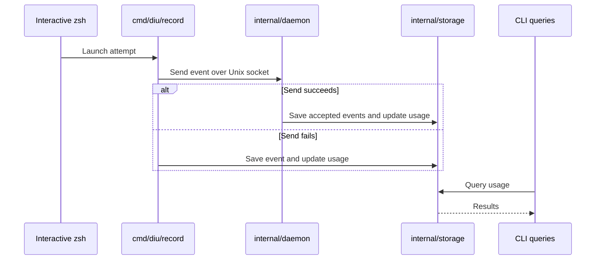

# Internal Packages

<!-- package responsibilities from internal production entry points -->
```text
internal/
├── core/           Configuration and record types
├── daemon/         Events, sockets, HTTP API, scheduled work
├── dx/             Commands, terminal UI, process runner
├── helpers/        Collections, line parsing, cancellable waits
├── monitors/       Package inventory and command parsing
├── observability/  Logs and redaction
├── safefs/         File access and atomic writes
└── storage/        Inventory, history, backups
```

File conventions: [AGENTS.md](AGENTS.md). Tests sit beside their source.

## Recording

<!-- launch recording sequence from zshPreexecHook, runRecorderWorker, and Daemon.storeExecutions -->


Recording is best effort.
